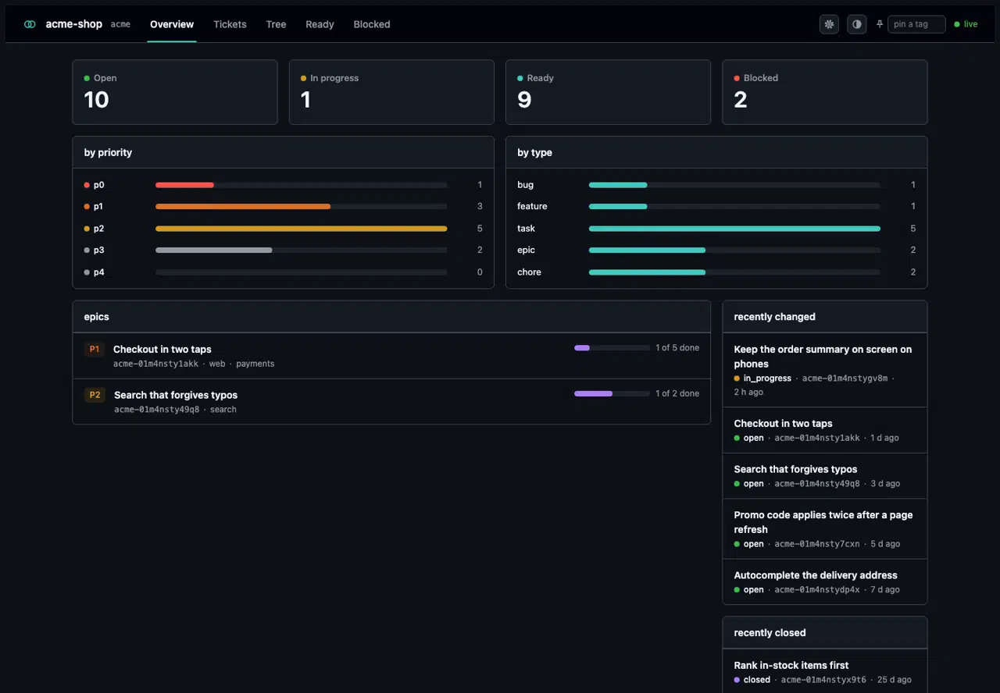

# knotview

A read-only web panel over a [knot](https://github.com/UniSoma/knot) backlog, shaped by the
project's own configuration rather than by this panel's idea of one.

**Built on knot.** [knot](https://github.com/UniSoma/knot), by
[UniSoma](https://github.com/UniSoma), is the ticket tracker this panel reads: markdown tickets
with YAML frontmatter that live in the repository beside the code, a dependency graph with ready
and blocked queues, acceptance criteria that gate closing, documents attached to tickets, and a
JSON protocol on every command built for handing work to an agent. Everything this panel shows is knot's data and knot's
vocabulary. If you have not met knot, start there: its README explains the design, and
`knot serve` ships a panel of its own that this one grew out of wanting more of.

- [A look at it](#a-look-at-it)
- [Quick start](#quick-start)
- [Saved projects](#saved-projects)
- [What it shows](#what-it-shows)
- [Developing](#developing)
- [Design](#design)
- [Licence](#licence)

## A look at it



The tour shows a small demo backlog in the dark theme. The panel follows your system theme, and
the switch in the header picks light or dark instead. [What it shows](#what-it-shows) describes
each page. To make the tour again, run `uv run python -m scripts.capture_screenshots`.

## Quick start

### Requirements

| You need | Because |
|---|---|
| Python 3.12 or later | the package targets it |
| `knot` 0.15.0 or later on your `PATH`, or `--knot /path/to/knot` | knotview never reads ticket files; it runs `knot ... --json` and shows the answer, and attached documents arrived in knot 0.15 |
| A knot project: a directory holding `.knot.edn` or `.tickets/` | that is what knot reads |

### Install and run

```bash
uv tool install git+https://github.com/krimsonkla/knotview
knotview --repository /path/to/a/knot/project --port 7778
```

Then open <http://127.0.0.1:7778/>.

From a checkout instead: `uv sync --all-groups`, then
`uv run knotview --repository /path/to/a/knot/project`. A plain `pip install .` also works and
installs the `knotview` command.

The panel binds loopback only and has no authentication, because it shows a whole backlog to
whoever can reach it. Do not put it on a network.

## Saved projects

Two projects open at once is the ordinary case, and each needs its own port, so a project's path
and port can be saved under a name and served by that name afterwards:

```bash
knotview --repository ~/git/one --port 7778 --save one
knotview --repository ~/git/two --port 7779 --save two
knotview one
knotview two
```

A flag still wins for one run: `knotview one --port 8000` serves the saved path on another port
without changing what is saved. The names live in `~/.config/knotview/projects.toml`, or under
`XDG_CONFIG_HOME` where that is set, as plain TOML you can edit. They are saved per machine rather
than in the project, because which port is free and where a checkout lives are facts about the
machine.

## What it shows

Every page is a GET and every filter is a query parameter, so any view is a link you can keep.

The header holds the page tabs, the worktree you are reading, the theme switch, any tags you
pinned, and a live mark that shows the page is following the backlog. On the overview it also
holds a gear that chooses which charts to show:

- **Pinned tags** narrow every page to tickets carrying all of them, until you unpin them. The
  choice lives in a cookie in your browser. The panel still writes nothing.
- **Worktrees** appear when the repository has more than one. Choose one and every page reads
  that worktree's backlog, since each worktree holds its own copy of `.tickets/`. A worktree git
  no longer lists falls back to the directory the panel was started in. This needs git 2.36 or
  later; without it, the panel reads the one directory.
- **The theme switch** cycles System, Light and Dark. Your choice is kept in this browser.

Every instant is shown in your browser's timezone, and the exact UTC instant is on hover. Without
script the page shows UTC, labelled as such.

| Page | What is on it |
|---|---|
| **Overview** `/` | Counts of open, in progress, ready and blocked tickets, each a link to its list. Charts by priority and by type; the gear adds charts by status, closed status, documents and queues, a chart by tag that shows how many of each tag's tickets are closed, and three charts over the last twelve weeks: open tickets, tickets opened and closed, and lead time by type. Your choice is kept in this browser. The integrity check's report, when there is one. Each epic, or whatever type the parents are, with how many of its children are closed and, when it states them, its own criteria; with no parents, the tickets ready to start, the ones that free the most other work first. When there are parents, the gear can add *start here*, which names the ready tickets that free the most. Recently changed and recently closed, five each. Tickets ready to close, and tickets gone stale. |
| **Tickets** `/tickets` | One row per ticket: status, title, tags, document types, a dashed type a required document is missing, id, type, assignee, when it changed, and priority. Every status, type, tag, assignee and priority is a link to the list filtered by it. Search, and the Status, Type, Priority, Tag and Sort menus apply as you choose them, each option showing how many tickets it leaves. More filters opens a dialog for mode, assignee, island, documents, searching the text and including closed tickets; it applies when you press Apply. Each active filter is a chip you can remove. |
| **Tree** `/tree` | What is filed under what, to any depth. Each branch folds, and the fold is remembered in your browser. Island links name knot's connected components. Tickets filed under nothing, or under a parent that is not live, are listed on their own, because that is where work goes missing. |
| **Queues** `/queue/ready`, `/queue/blocked` | knot's own queues, in the same rows as the tickets list. The ready queue is ordered by how many tickets closing each one frees, then by priority. Each of its rows says that number, for example "frees 7". It is knot's leverage. The blocked queue is grouped by level into the rounds of closing before each ticket can start. |
| **Ticket** `/ticket/<id>` | The title and one summary line, then the ticket's documents as cards, then the description, folded after its first two paragraphs. Later sections and the notes fold. Children, blocked by and blocking, linked tickets, siblings, and knot's dependency tree sit behind tabs, and empty ones are not drawn. A sidebar holds the documents, priority, assignee, tags, progress, parent, mode and external links. Folds and the chosen tab survive the page reloading itself. Markdown tables render as tables. |
| **Document** `/document/<id>` | One document in a readable column, with tabs across the ticket's other documents, an *all* menu listing them by type, and an outline of its headings. A document whose ticket knot cannot find still reads, and the start of an id works as knot resolves it. |
| **Live** | Each open page asks about once a second whether the backlog changed, and reloads itself when it has, documents included. Rows in the lists saved since you last looked carry a mark at their left edge, and the header counts them; click the count to clear the marks. The overview's short lists carry no marks. |

## Developing

The panel is developed inside a [devenv](https://devenv.sh) shell, which supplies Python, uv,
knot, the formatters and the commit hooks. `devenv up` serves the panel over this repository's
own backlog, which is the fixture the panel is developed against:

```bash
devenv shell          # everything on PATH, uv sync already run
devenv up             # serves http://127.0.0.1:7778/ over this repository
KNOTVIEW_REPOSITORY=/path/to/another/project KNOTVIEW_PORT=7779 devenv up
```

That shell pulls its hooks and knot from a private layer repository, so today it evaluates only
for the maintainer. Nothing in the package or the tests depends on it: `uv sync --all-groups`
gives you the same tools, and [CONTRIBUTING.md](CONTRIBUTING.md) lists every check, the coverage
gate, and how the recorded test fixtures are kept honest against a real knot.

## Design

**It reads.** Nothing here writes a ticket. Every route is a GET, the only commands it runs are
knot's read verbs and `git worktree list`, and only two modules can start a process; tests
assert all three. The backlog
stays driven by whatever drives it.

**It reads through knot.** Through `knot ... --json`, never by parsing `.tickets/` directly. knot
owns that schema; a second parser here would be a second schema, and it would drift on the first
release that adds a field.

**It looks like itself.** Colours, type and spacing come from
[Primer Primitives](https://primer.style/primitives) (MIT), kept in the package rather than
loaded from a CDN, with knotview's own teal accent.

**It follows without being asked.** Each page polls a digest of the ticket and document files
rather than markup, so what you see after a change is exactly what a fresh visit shows: one rendering
path.

**Why not `knot serve`?** knot ships its own panel, and it is good at what it does: three fixed
groups, in progress over ready over blocked, expanded inline. What it does not do is navigate a
project's own types, filter, show the closed work, draw the shape of what is filed under what,
or follow changes without being asked. That is what this adds.

## Licence

MIT. See [LICENSE](LICENSE).
